# Modelo entidad-relación — Plataforma de adopción de mascotas (MVP)

> Diseño de la base de datos PostgreSQL 18 a partir de las [reglas de negocio](reglas-de-negocio.md). Los nombres siguen las convenciones de la [sección 1](#nombres) y de las [especificaciones técnicas](especificaciones-tecnicas.md), con las equivalencias castellano–inglés en el [glosario](especificaciones-tecnicas.md#8-glosario-castellanoinglés).
>
> **Última actualización:** 24/11/2026

---

## Índice

1. [Criterios generales](#1-criterios-generales)
2. [Diagrama](#2-diagrama)
3. [Tablas](#3-tablas)
   - [3.1 Catálogos](#31-catálogos)
   - [3.2 Usuarios y acceso](#32-usuarios-y-acceso)
   - [3.3 Preferencias](#33-preferencias)
   - [3.4 Mascotas](#34-mascotas)
   - [3.5 Turnos y visitas](#35-turnos-y-visitas)
   - [3.6 Adopciones](#36-adopciones)
   - [3.7 Chat y notificaciones](#37-chat-y-notificaciones)
   - [3.8 Bloqueos, notas, suspensiones e incidencias](#38-bloqueos-notas-suspensiones-e-incidencias)
   - [3.9 Auditoría](#39-auditoría)
4. [Restricciones que no puede garantizar la base de datos](#4-restricciones-que-no-puede-garantizar-la-base-de-datos)
5. [Datos calculados](#5-datos-calculados)
6. [Consultas clave](#6-consultas-clave)

---

## 1. Criterios generales

### Nombres

| Elemento | Convención | Ejemplos |
|---|---|---|
| **Tablas principales** | Primera letra en mayúscula y el resto en `snake_case`, en singular. | `App_user`, `Pet`, `Visit_slot`, `Email_token` |
| **Tablas intermedias** (rompen una relación muchos a muchos) | Todo en `snake_case`: los nombres de las dos tablas que relacionan, terminados en `_rel`. | `pet_species_rel`, `adopter_pet_rel` |
| **Columnas, índices y restricciones** | `snake_case`. | `shelter_id`, `created_at` |
| **Valores de estado** | Mayúsculas. | `PENDING`, `NO_SHOW` |

> ⚠️ **Comillas dobles obligatorias en las tablas principales.** PostgreSQL convierte a minúsculas los nombres que no van entre comillas: `CREATE TABLE App_user` crearía la tabla `app_user`. Para conservar la mayúscula, las tablas principales se escriben **siempre entre comillas dobles** en `schema.sql`, consultas y herramientas (`"App_user"`, `"Pet"`). Si se olvidan, PostgreSQL responde `relation "pet" does not exist`. Las tablas intermedias y las columnas van en minúsculas y no necesitan comillas.
>
> ```sql
> SELECT p.name, r.type
> FROM "Pet" p
> JOIN adopter_pet_rel r ON r.pet_id = p.id
> WHERE p.status = 'AVAILABLE';
> ```

### Otros criterios

| Tema | Decisión |
|---|---|
| Claves primarias | `bigint GENERATED ALWAYS AS IDENTITY`. Los perfiles (`Adopter`, `Shelter`) usan como clave el `id` de su `App_user` (relación 1 a 1). Las tablas intermedias usan como clave el par de claves foráneas. |
| Valores de estado | Columnas `text` con una restricción `CHECK` que enumera los valores válidos, en lugar de tipos `ENUM` nativos. Añadir o quitar un valor solo requiere cambiar el `CHECK`, mientras que un `ENUM` no permite quitar valores. |
| Fechas | `timestamptz` para los instantes y `date` para las fechas de nacimiento. Referencia horaria: `Europe/Madrid`. |
| Borrado | Ningún registro con historial se borra físicamente (RN-59, RN-172): se usan estados y columnas de fecha (`deleted_at`, `lifted_at`, `cancelled_at`…). Las claves foráneas impiden borrar una fila referenciada (comportamiento por defecto de PostgreSQL), salvo las tablas técnicas (`Session`, `Email_token`) y las intermedias de preferencias (`adopter_preferences_*_rel`), que usan `ON DELETE CASCADE` porque no tienen historial. |
| Auditoría | Las tablas principales tienen `created_at` y, si se editan, `updated_at`. |
| Imágenes | Solo se guarda su ruta (RN-52). |
| Emails | Únicos sin distinguir mayúsculas: índice único sobre `lower(email)`. |
| Concurrencia | Para no superar la capacidad de un turno, la solicitud de visita bloquea la fila del turno (`SELECT ... FOR UPDATE`) antes de contar las plazas, dentro de la misma transacción. |

**Leyenda de las tablas:** **PK** clave primaria · **FK** clave foránea · **UQ** único · **NN** no nulo.

---

## 2. Diagrama

El diagrama muestra solo las claves. Las columnas completas están en la [sección 3](#3-tablas).

```mermaid
erDiagram
    App_user ||--o| Adopter : "es"
    App_user ||--o| Shelter : "es"
    App_user ||--o{ Session : "tiene"
    App_user ||--o{ Email_token : "recibe"
    App_user ||--o{ Suspension : "sufre"
    App_user ||--o{ Notification : "recibe"
    App_user ||--o{ Message : "envía"
    App_user ||--o{ Incident : "abre / es reportado"
    App_user |o--o{ Audit_log : "realiza"

    Province ||--o{ Adopter : "ubica"
    Province ||--o{ Shelter : "ubica"
    Species ||--o{ Breed : "agrupa"

    Adopter ||--o| Adopter_preferences : "rellena"
    Adopter_preferences ||--o{ adopter_preferences_species_rel : ""
    Species ||--o{ adopter_preferences_species_rel : ""
    Adopter_preferences ||--o{ adopter_preferences_breed_rel : ""
    Breed ||--o{ adopter_preferences_breed_rel : ""

    Shelter ||--o{ Pet : "publica"
    Breed ||--o{ Pet : "clasifica"
    Pet ||--o{ Pet_photo : "tiene"
    Pet ||--o{ pet_species_rel : "convive con"
    Species ||--o{ pet_species_rel : ""

    Adopter ||--o{ adopter_pet_rel : "valora"
    Pet ||--o{ adopter_pet_rel : "es valorada"

    Shelter ||--o{ Visit_slot : "ofrece"
    Visit_slot ||--o{ Visit : "acoge"
    Pet ||--o{ Visit : "es visitada"
    Adopter ||--o{ Visit : "solicita"
    Visit |o--o{ Visit : "sustituye a"

    Visit ||--o{ Adoption : "habilita"
    Adopter ||--o{ Adoption : "solicita"
    Pet ||--o{ Adoption : "es adoptada"

    Adopter ||--o{ Conversation : "participa"
    Shelter ||--o{ Conversation : "participa"
    Conversation ||--o{ Message : "contiene"

    Shelter ||--o{ Block : "bloquea"
    Adopter ||--o{ Block : "es bloqueado"
    Shelter ||--o{ Adopter_note : "escribe"
    Adopter ||--o{ Adopter_note : "trata de"

    App_user { bigint id PK }
    Adopter { bigint user_id PK,FK }
    Shelter { bigint user_id PK,FK }
    Session { text token_hash PK }
    Email_token { bigint id PK }
    Province { smallint id PK }
    Species { smallint id PK }
    Breed { int id PK }
    Adopter_preferences { bigint adopter_id PK,FK }
    adopter_preferences_species_rel { bigint adopter_id PK,FK }
    adopter_preferences_breed_rel { bigint adopter_id PK,FK }
    Pet { bigint id PK }
    Pet_photo { bigint id PK }
    pet_species_rel { bigint pet_id PK,FK }
    adopter_pet_rel { bigint adopter_id PK,FK }
    Visit_slot { bigint id PK }
    Visit { bigint id PK }
    Adoption { bigint id PK }
    Conversation { bigint id PK }
    Message { bigint id PK }
    Notification { bigint id PK }
    Block { bigint id PK }
    Adopter_note { bigint id PK }
    Suspension { bigint id PK }
    Incident { bigint id PK }
    Audit_log { bigint id PK }
```



---

## 3. Tablas

### 3.1 Catálogos

Se cargan al final de `schema.sql`. Solo el administrador puede añadir o editar especies y razas (RN-42).

#### `Province`

| Columna | Tipo | Restricciones | Notas |
|---|---|---|---|
| `id` | `smallint` | PK | Código INE de la provincia (1–52). |
| `name` | `text` | NN, UQ | |

#### `Species`

| Columna | Tipo | Restricciones | Notas |
|---|---|---|---|
| `id` | `smallint` | PK, identidad | |
| `name` | `text` | NN, UQ | "Perro", "Gato" (RN-39). |

#### `Breed`

| Columna | Tipo | Restricciones | Notas |
|---|---|---|---|
| `id` | `int` | PK, identidad | |
| `species_id` | `smallint` | NN, FK → `Species` | La especie de la mascota se obtiene de aquí (RN-41). |
| `name` | `text` | NN | Cada especie tiene "Mestizo / Desconocida" (RN-40). |

UQ (`species_id`, `name`).

---

### 3.2 Usuarios y acceso

#### `App_user`

Una fila por cuenta, con independencia del rol (RN-04). El administrador no tiene perfil propio (RN-05).

| Columna | Tipo | Restricciones | Notas |
|---|---|---|---|
| `id` | `bigint` | PK, identidad | |
| `email` | `text` | NN | UQ sobre `lower(email)` (RN-06). Al eliminar la cuenta se sustituye por un valor anónimo único. |
| `password_hash` | `text` | NN | Argon2id (RN-08). |
| `role` | `text` | NN, CHECK `ADOPTER`, `SHELTER`, `ADMIN` | |
| `email_verified_at` | `timestamptz` | | `NULL` = sin verificar (RN-07). |
| `terms_accepted_at` | `timestamptz` | NN | RN-186. |
| `existing_account_notice_at` | `timestamptz` | | Último aviso de "alguien ha intentado registrarse con tu email", para limitarlo a uno cada 5 minutos (RN-182). |
| `deleted_at` | `timestamptz` | | Cuenta eliminada y anonimizada (RN-11). |
| `created_at` | `timestamptz` | NN, por defecto `now()` | |
| `updated_at` | `timestamptz` | NN, por defecto `now()` | |

#### `Adopter`

| Columna | Tipo | Restricciones | Notas |
|---|---|---|---|
| `user_id` | `bigint` | PK, FK → `App_user` | |
| `first_name` | `text` | NN | |
| `last_name` | `text` | NN | |
| `phone` | `text` | NN | |
| `birth_date` | `date` | NN | Mayor de edad (RN-25); se comprueba en el servicio. |
| `province_id` | `smallint` | NN, FK → `Province` | RN-26. |
| `locality` | `text` | NN | |
| `housing_type` | `text` | CHECK `APARTMENT`, `HOUSE`, `OTHER` | **Datos del hogar** (RN-27): todos opcionales al registrarse y obligatorios para solicitar una adopción. |
| `has_outdoor_space` | `boolean` | | Jardín o terraza. |
| `housing_tenure` | `text` | CHECK `OWNED`, `RENTED` | |
| `household_members` | `smallint` | CHECK ≥ 1 | Personas que conviven, incluido el adoptante. |
| `has_children` | `boolean` | | |
| `has_other_pets` | `boolean` | | |
| `other_pets_description` | `text` | | Texto libre (RN-28). |
| `has_pet_experience` | `boolean` | | |
| `hours_alone_per_day` | `smallint` | CHECK 0–24 | |
| `updated_at` | `timestamptz` | NN | |

#### `Shelter`

| Columna | Tipo | Restricciones | Notas |
|---|---|---|---|
| `user_id` | `bigint` | PK, FK → `App_user` | Una cuenta por protectora (RN-09). |
| `name` | `text` | NN | |
| `cif` | `text` | NN, UQ | RN-17. |
| `description` | `text` | | |
| `logo_path` | `text` | | |
| `address` | `text` | NN | Lugar de las visitas (RN-193). |
| `province_id` | `smallint` | NN, FK → `Province` | RN-21. |
| `locality` | `text` | NN | |
| `phone` | `text` | NN | |
| `contact_email` | `text` | | Público y opcional (RN-20). |
| `website` | `text` | | |
| `opening_hours` | `text` | | |
| `validation_status` | `text` | NN, por defecto `PENDING`, CHECK `PENDING`, `VALIDATED`, `REJECTED` | RN-14. |
| `validation_reason` | `text` | | Obligatorio si `REJECTED` (RN-18, RN-19): CHECK (`validation_status <> 'REJECTED' OR validation_reason IS NOT NULL`). |
| `validated_at` | `timestamptz` | | |
| `updated_at` | `timestamptz` | NN | |

#### `Session`

| Columna | Tipo | Restricciones | Notas |
|---|---|---|---|
| `token_hash` | `text` | PK | Hash SHA-256 del token de la cookie. El token en claro nunca se guarda. |
| `user_id` | `bigint` | NN, FK → `App_user` (CASCADE) | |
| `created_at` | `timestamptz` | NN | |
| `expires_at` | `timestamptz` | NN | Se amplía 30 días si se usa cuando le quedan menos de 15 (RN-176). |

#### `Email_token`

Enlaces de verificación, de restablecimiento de contraseña y de cambio de email.

| Columna | Tipo | Restricciones | Notas |
|---|---|---|---|
| `id` | `bigint` | PK, identidad | |
| `user_id` | `bigint` | NN, FK → `App_user` (CASCADE) | |
| `purpose` | `text` | NN, CHECK `VERIFY_EMAIL`, `RESET_PASSWORD`, `CHANGE_EMAIL` | |
| `token_hash` | `text` | NN, UQ | |
| `new_email` | `text` | | Solo para `CHANGE_EMAIL` (CU-49). |
| `created_at` | `timestamptz` | NN | Para la espera de 5 minutos entre envíos (RN-180, RN-181). |
| `expires_at` | `timestamptz` | NN | 24 h o 30 min (RN-177, RN-178). |
| `used_at` | `timestamptz` | | Un solo uso. |
| `revoked_at` | `timestamptz` | | Se rellena al pedir un enlace nuevo del mismo tipo (RN-180, RN-181). |

---

### 3.3 Preferencias

Cuestionario del adoptante (RN-30 a RN-38). Una lista vacía o un valor `NULL` significa "me da igual" (RN-34, RN-35).

Los valores que son de un catálogo (especies, razas) van en **tablas intermedias**, para poder tener claves foráneas. Los valores de una lista fija (tamaño, sexo, actividad) van en **arrays** de PostgreSQL, que es más sencillo y no necesita tablas extra.

#### `Adopter_preferences`

| Columna | Tipo | Restricciones | Notas |
|---|---|---|---|
| `adopter_id` | `bigint` | PK, FK → `Adopter` | La fila existe solo si ha rellenado el cuestionario (RN-190, RN-199). |
| `sizes` | `text[]` | NN, por defecto `{}` | CHECK (`sizes <@ ARRAY['SMALL','MEDIUM','LARGE']`). |
| `sexes` | `text[]` | NN, por defecto `{}` | CHECK (`sexes <@ ARRAY['MALE','FEMALE']`). |
| `activity_levels` | `text[]` | NN, por defecto `{}` | CHECK (`activity_levels <@ ARRAY['LOW','MEDIUM','HIGH']`). |
| `min_age_months` | `smallint` | CHECK ≥ 0 | Rango de edad (RN-205). |
| `max_age_months` | `smallint` | CHECK ≥ 0 | CHECK (`min_age_months <= max_age_months`) si ambos existen. |
| `needs_good_with_children` | `boolean` | NN, por defecto `false` | RN-36. |
| `updated_at` | `timestamptz` | NN | |

#### `adopter_preferences_species_rel`

Recoge las dos preguntas del cuestionario que tratan de especies. Hay una fila por cada especie marcada en al menos una de ellas.

| Columna | Tipo | Restricciones | Notas |
|---|---|---|---|
| `adopter_id` | `bigint` | PK, FK → `Adopter_preferences` | |
| `species_id` | `smallint` | PK, FK → `Species` | |
| `is_wanted` | `boolean` | NN | Le interesa esta especie. Si ninguna fila tiene `is_wanted`, la especie es "me da igual". |
| `must_get_along` | `boolean` | NN | La mascota debe llevarse bien con esta especie. Si marca varias, debe llevarse bien con **todas** (RN-37). |

CHECK (`is_wanted OR must_get_along`): no se guardan filas vacías.

#### `adopter_preferences_breed_rel`

| Columna | Tipo | Restricciones | Notas |
|---|---|---|---|
| `adopter_id` | `bigint` | PK, FK → `Adopter_preferences` | |
| `breed_id` | `int` | PK, FK → `Breed` | Razas que le interesan. Sin filas = "me da igual". |

---

### 3.4 Mascotas

#### `Pet`

| Columna | Tipo | Restricciones | Notas |
|---|---|---|---|
| `id` | `bigint` | PK, identidad | |
| `shelter_id` | `bigint` | NN, FK → `Shelter` | UQ (`id`, `shelter_id`) para la FK compuesta de `Visit`. |
| `breed_id` | `int` | NN, FK → `Breed` | |
| `name` | `text` | NN | |
| `description` | `text` | NN | |
| `birth_date` | `date` | NN | Aproximada (RN-43). |
| `sex` | `text` | NN, CHECK `MALE`, `FEMALE` | |
| `size` | `text` | NN, CHECK `SMALL`, `MEDIUM`, `LARGE` | |
| `activity_level` | `text` | NN, CHECK `LOW`, `MEDIUM`, `HIGH` | |
| `good_with_children` | `text` | NN, por defecto `UNKNOWN`, CHECK `YES`, `NO`, `UNKNOWN` | RN-45. |
| `vaccinated` | `boolean` | NN | RN-47. |
| `dewormed` | `boolean` | NN | |
| `sterilized` | `boolean` | NN | |
| `microchipped` | `boolean` | NN | Sin el número. |
| `special_needs` | `text` | | |
| `status` | `text` | NN, por defecto `AVAILABLE`, CHECK `AVAILABLE`, `RESERVED`, `ADOPTED`, `UNLISTED` | RN-53 a RN-57. |
| `unlist_reason` | `text` | CHECK `DECEASED`, `TRANSFERRED`, `TREATMENT`, `FOSTER`, `ERROR`, `OTHER`, `REMOVED_BY_ADMIN` | RN-62. CHECK (`(status = 'UNLISTED') = (unlist_reason IS NOT NULL)`). |
| `unlisted_at` | `timestamptz` | | |
| `created_at` | `timestamptz` | NN | Fecha de alta (RN-49). |
| `updated_at` | `timestamptz` | NN | |

#### `Pet_photo`

| Columna | Tipo | Restricciones | Notas |
|---|---|---|---|
| `id` | `bigint` | PK, identidad | |
| `pet_id` | `bigint` | NN, FK → `Pet` | |
| `path` | `text` | NN | |
| `position` | `smallint` | NN, CHECK 1–6 | La 1 es la principal (RN-51). |

UQ (`pet_id`, `position`) `DEFERRABLE INITIALLY DEFERRED`, para poder reordenar las fotos en una transacción. Junto con el CHECK 1–6, garantiza que una mascota tenga como mucho 6 fotos (RN-50).

#### `pet_species_rel`

Convivencia de la mascota con otras especies (RN-46). Si no hay fila para una especie, la convivencia es desconocida.

| Columna | Tipo | Restricciones | Notas |
|---|---|---|---|
| `pet_id` | `bigint` | PK, FK → `Pet` | |
| `species_id` | `smallint` | PK, FK → `Species` | |
| `gets_along` | `boolean` | NN | `true` = SÍ, `false` = NO. |

#### `adopter_pet_rel`

Valoraciones del adoptante: favoritos y descartes. Una por adoptante y mascota (RN-74). Sin historial (RN-76).

| Columna | Tipo | Restricciones | Notas |
|---|---|---|---|
| `adopter_id` | `bigint` | PK, FK → `Adopter` | |
| `pet_id` | `bigint` | PK, FK → `Pet` | |
| `type` | `text` | NN, CHECK `FAVORITE`, `DISCARDED` | |
| `created_at` | `timestamptz` | NN | Un descarte deja de valer a los 15 días (RN-75). El último descarte, el que se puede deshacer (RN-191), es el `DISCARDED` más reciente. |

---

### 3.5 Turnos y visitas

#### `Visit_slot`

| Columna | Tipo | Restricciones | Notas |
|---|---|---|---|
| `id` | `bigint` | PK, identidad | UQ (`id`, `shelter_id`) para la FK compuesta de `Visit`. |
| `shelter_id` | `bigint` | NN, FK → `Shelter` | |
| `starts_at` | `timestamptz` | NN | |
| `ends_at` | `timestamptz` | NN | CHECK (`ends_at > starts_at`) (RN-84). |
| `capacity` | `smallint` | NN, CHECK ≥ 1 | RN-84. |
| `cancelled_at` | `timestamptz` | | Turno eliminado (RN-85). |
| `created_at` | `timestamptz` | NN | |

**Modificar la fecha o el horario de un turno con visitas** (RN-111): el turno original se marca con `cancelled_at`, se crea uno nuevo y las visitas pasan a `VOIDED` (`SLOT_CANCELLED`). Así las visitas anuladas conservan la fecha y la hora que tenían. Un cambio de capacidad se hace sobre el mismo turno.

#### `Visit`

| Columna | Tipo | Restricciones | Notas |
|---|---|---|---|
| `id` | `bigint` | PK, identidad | |
| `adopter_id` | `bigint` | NN, FK → `Adopter` | |
| `shelter_id` | `bigint` | NN | Solo para las FK compuestas de abajo. |
| `pet_id` | `bigint` | NN | FK (`pet_id`, `shelter_id`) → `Pet` (`id`, `shelter_id`). |
| `slot_id` | `bigint` | NN | FK (`slot_id`, `shelter_id`) → `Visit_slot` (`id`, `shelter_id`). Así la mascota y el turno son siempre de la misma protectora (RN-83). |
| `status` | `text` | NN, por defecto `PENDING`, CHECK `PENDING`, `CONFIRMED`, `REJECTED`, `CANCELLED`, `EXPIRED`, `VOIDED`, `COMPLETED`, `NO_SHOW` | Sección 8.9 de las reglas. |
| `replaces_visit_id` | `bigint` | FK → `Visit` | Visita que sustituye: por cambio de turno (RN-111, nace `CONFIRMED`) o por reprogramación (RN-196). |
| `responded_at` | `timestamptz` | | Confirmación o rechazo. |
| `rejection_reason` | `text` | | Opcional (RN-96). |
| `cancelled_by` | `text` | CHECK `ADOPTER`, `SHELTER` | RN-101. CHECK (`(status = 'CANCELLED') = (cancelled_by IS NOT NULL)`). |
| `cancelled_at` | `timestamptz` | | |
| `void_reason` | `text` | CHECK `PET_RESERVED`, `PET_UNLISTED`, `ADOPTER_BLOCKED`, `NO_SHOW`, `SLOT_CANCELLED`, `ADOPTER_SUSPENDED`, `ACCOUNT_DELETED` | RN-109. CHECK (`(status = 'VOIDED') = (void_reason IS NOT NULL)`). |
| `voided_at` | `timestamptz` | | |
| `attendance_marked_by` | `text` | CHECK `SHELTER`, `SYSTEM`, `ADMIN` | Quién marcó `COMPLETED` o `NO_SHOW` (RN-107, RN-108). |
| `attendance_marked_at` | `timestamptz` | | |
| `reminder_sent_at` | `timestamptz` | | Recordatorio enviado (RN-197). |
| `created_at` | `timestamptz` | NN | Fecha de la solicitud: el plazo de 24 h para responder cuenta desde aquí (RN-94). |

Índices:
- UQ (`pet_id`, `slot_id`) WHERE `status IN ('PENDING','CONFIRMED')`: una visita activa por mascota y turno (RN-81).
- (`slot_id`) WHERE `status IN ('PENDING','CONFIRMED')`: contar plazas ocupadas (RN-82).
- (`adopter_id`, `shelter_id`, `status`): cupo y visitas no asistidas (RN-89, RN-90).

---

### 3.6 Adopciones

#### `Adoption`

| Columna | Tipo | Restricciones | Notas |
|---|---|---|---|
| `id` | `bigint` | PK, identidad | |
| `adopter_id` | `bigint` | NN, FK → `Adopter` | |
| `pet_id` | `bigint` | NN, FK → `Pet` | |
| `visit_id` | `bigint` | NN, FK → `Visit` | Visita realizada que la habilita (RN-113, RN-114). |
| `questionnaire_answers` | `jsonb` | NN | Cuestionario de adopción (RN-207). Se guarda como JSON porque las preguntas aún no están definidas y pueden cambiar sin migrar. |
| `status` | `text` | NN, por defecto `PENDING`, CHECK `PENDING`, `APPROVED`, `REJECTED`, `NOT_SELECTED`, `CANCELLED`, `VOIDED`, `COMPLETED`, `RETURNED` | Sección 9.4 de las reglas. |
| `decided_at` | `timestamptz` | | Aprobación, rechazo o no selección. |
| `rejection_reason` | `text` | | Obligatorio si `REJECTED` (RN-123). |
| `cancelled_by` | `text` | CHECK `ADOPTER`, `SHELTER`, `SYSTEM` | RN-129. CHECK (`(status = 'CANCELLED') = (cancelled_by IS NOT NULL)`). |
| `cancellation_reason` | `text` | | |
| `cancelled_at` | `timestamptz` | | |
| `void_reason` | `text` | CHECK `PET_UNLISTED`, `ADOPTER_BLOCKED`, `NO_SHOW`, `ADOPTER_SUSPENDED`, `ACCOUNT_DELETED` | RN-132. CHECK (`(status = 'VOIDED') = (void_reason IS NOT NULL)`). |
| `voided_at` | `timestamptz` | | |
| `delivered_at` | `timestamptz` | | Entrega (RN-126). |
| `returned_at` | `timestamptz` | | Devolución (RN-131). |
| `return_reason` | `text` | | Obligatorio si `RETURNED`. |
| `last_pending_reminder_at` | `timestamptz` | | Recordatorio cada 3 días (RN-122). |
| `last_delivery_reminder_at` | `timestamptz` | | Recordatorio diario (RN-127). |
| `admin_alerted_at` | `timestamptz` | | Aviso al administrador a los 5 días (RN-128). |
| `created_at` | `timestamptz` | NN | |

Índices:
- UQ (`adopter_id`, `pet_id`) WHERE `status IN ('PENDING','APPROVED')`: una solicitud abierta por mascota (RN-119).
- UQ (`pet_id`) WHERE `status IN ('APPROVED','COMPLETED')`: una adopción aprobada o completada por mascota (RN-125).

---

### 3.7 Chat y notificaciones

#### `Conversation`

| Columna | Tipo | Restricciones | Notas |
|---|---|---|---|
| `id` | `bigint` | PK, identidad | |
| `adopter_id` | `bigint` | NN, FK → `Adopter` | |
| `shelter_id` | `bigint` | NN, FK → `Shelter` | |
| `created_at` | `timestamptz` | NN | Primera solicitud de visita (RN-134). |

UQ (`adopter_id`, `shelter_id`): una conversación por pareja (RN-133). Es una tabla principal, no intermedia, porque es una entidad con identidad propia de la que cuelgan los mensajes. Si se puede escribir o no, se calcula (bloqueo activo, cuenta eliminada), no se guarda.

#### `Message`

| Columna | Tipo | Restricciones | Notas |
|---|---|---|---|
| `id` | `bigint` | PK, identidad | |
| `conversation_id` | `bigint` | NN, FK → `Conversation` | |
| `sender_id` | `bigint` | NN, FK → `App_user` | Si la cuenta está eliminada, se muestra "Usuario eliminado" (RN-13). |
| `body` | `text` | | |
| `attachment_path` | `text` | | Foto adjunta (RN-139). |
| `attachment_type` | `text` | CHECK `IMAGE` | Si se aceptan vídeos, se añade `VIDEO`. CHECK (`(attachment_path IS NULL) = (attachment_type IS NULL)`). |
| `read_at` | `timestamptz` | | RN-138. |
| `created_at` | `timestamptz` | NN | |

CHECK (`body IS NOT NULL OR attachment_path IS NOT NULL`). Índice (`conversation_id`, `id`) para el *polling* de mensajes nuevos.

#### `Notification`

| Columna | Tipo | Restricciones | Notas |
|---|---|---|---|
| `id` | `bigint` | PK, identidad | |
| `user_id` | `bigint` | NN, FK → `App_user` | |
| `type` | `text` | NN | Tipos de RN-144. Sin CHECK, porque la lista es abierta. |
| `title` | `text` | NN | Generado con plantilla al crearla (RN-143), para que no cambie si después cambia la plantilla. |
| `body` | `text` | NN | |
| `visit_id` | `bigint` | FK → `Visit` | Elemento que se abre al pulsarla. |
| `adoption_id` | `bigint` | FK → `Adoption` | |
| `pet_id` | `bigint` | FK → `Pet` | Para "nueva mascota compatible" y "cambio en un favorito" (RN-199, RN-200). |
| `incident_id` | `bigint` | FK → `Incident` | |
| `read_at` | `timestamptz` | | |
| `created_at` | `timestamptz` | NN | |

CHECK (`num_nonnulls(visit_id, adoption_id, pet_id, incident_id) <= 1`): como mucho un elemento enlazado (RN-142). Índice (`user_id`, `read_at`) para el contador de no leídas.

---

### 3.8 Bloqueos, notas, suspensiones e incidencias

#### `Block`

Es una tabla principal y no intermedia: una misma pareja protectora–adoptante puede tener varios bloqueos a lo largo del tiempo (historial, RN-150), cada uno con su propio `id`.

| Columna | Tipo | Restricciones | Notas |
|---|---|---|---|
| `id` | `bigint` | PK, identidad | |
| `shelter_id` | `bigint` | NN, FK → `Shelter` | |
| `adopter_id` | `bigint` | NN, FK → `Adopter` | |
| `reason` | `text` | NN, CHECK `INAPPROPRIATE_BEHAVIOUR`, `FALSE_INFORMATION`, `BREACHES`, `OTHER` | Interno (RN-147). |
| `detail` | `text` | | |
| `created_at` | `timestamptz` | NN | Inicio del bloqueo. |
| `ends_at` | `timestamptz` | | Fin previsto: `created_at` + 15 días si es el primero; `NULL` si es definitivo (RN-201). |
| `lifted_at` | `timestamptz` | | Fin real, manual o automático (RN-150, RN-202). |
| `lifted_by` | `text` | CHECK `SHELTER`, `SYSTEM` | CHECK (`(lifted_at IS NULL) = (lifted_by IS NULL)`). |

UQ (`shelter_id`, `adopter_id`) WHERE `lifted_at IS NULL`: un bloqueo activo por pareja (RN-151). Un bloqueo nuevo es temporal si no existe ninguna fila anterior para esa pareja.

#### `Adopter_note`

| Columna | Tipo | Restricciones | Notas |
|---|---|---|---|
| `id` | `bigint` | PK, identidad | |
| `shelter_id` | `bigint` | NN, FK → `Shelter` | Solo la ve esa protectora (RN-204). |
| `adopter_id` | `bigint` | NN, FK → `Adopter` | |
| `body` | `text` | NN, CHECK no vacía | |
| `created_at` | `timestamptz` | NN | |
| `updated_at` | `timestamptz` | NN | |

Excepción a RN-172: es la única tabla en la que se borran filas, porque CU-52 permite eliminar notas y no tienen historial que conservar.

#### `Suspension`

| Columna | Tipo | Restricciones | Notas |
|---|---|---|---|
| `id` | `bigint` | PK, identidad | |
| `user_id` | `bigint` | NN, FK → `App_user` | |
| `reason` | `text` | NN, CHECK `INAPPROPRIATE_BEHAVIOUR`, `FALSE_INFORMATION`, `INAPPROPRIATE_CONTENT`, `FRAUD`, `REPEATED_INCIDENTS`, `OTHER` | RN-155. |
| `detail` | `text` | | |
| `started_at` | `timestamptz` | NN | |
| `ended_at` | `timestamptz` | | Reactivación (RN-156). |

UQ (`user_id`) WHERE `ended_at IS NULL`: una suspensión activa por usuario.

#### `Incident`

| Columna | Tipo | Restricciones | Notas |
|---|---|---|---|
| `id` | `bigint` | PK, identidad | |
| `reporter_id` | `bigint` | NN, FK → `App_user` | Quien la abre (RN-165). |
| `reported_id` | `bigint` | NN, FK → `App_user` | La otra parte. CHECK (`reporter_id <> reported_id`). |
| `reason` | `text` | NN, CHECK `WRONG_ATTENDANCE`, `INAPPROPRIATE_BEHAVIOUR`, `FALSE_INFORMATION`, `INAPPROPRIATE_CONTENT`, `UNFAIR_BLOCK`, `OTHER` | RN-167. |
| `description` | `text` | NN, CHECK no vacía | |
| `visit_id` | `bigint` | FK → `Visit` | Opcional (RN-166). |
| `adoption_id` | `bigint` | FK → `Adoption` | CHECK (`num_nonnulls(visit_id, adoption_id) <= 1`). |
| `status` | `text` | NN, por defecto `OPEN`, CHECK `OPEN`, `IN_REVIEW`, `RESOLVED`, `DISMISSED` | RN-168. |
| `resolution` | `text` | | Obligatoria si `RESOLVED` o `DISMISSED`. |
| `resolved_at` | `timestamptz` | | |
| `created_at` | `timestamptz` | NN | |

---

### 3.9 Auditoría

#### `Audit_log`

Registro de acciones relevantes (RN-208 a RN-210). Complementa el historial que ya guardan las propias tablas (estados, `cancelled_by`, `attendance_marked_by`…) con **quién** hizo cada acción y **qué valores cambiaron**.

| Columna | Tipo | Restricciones | Notas |
|---|---|---|---|
| `id` | `bigint` | PK, identidad | |
| `actor_user_id` | `bigint` | FK → `App_user` | Quién hizo la acción. `NULL` si la hizo el sistema (tareas programadas) o si no hay usuario identificado (inicio de sesión fallido). |
| `action` | `text` | NN | Código de la acción en mayúsculas: `SHELTER_VALIDATED`, `PET_UPDATED`, `LOGIN_FAILED`… Sin CHECK, porque la lista crecerá. |
| `entity_type` | `text` | | Tabla afectada (`Pet`, `Visit`, `Shelter`…). `NULL` en eventos sin entidad. |
| `entity_id` | `bigint` | | Fila afectada. Sin FK, porque puede apuntar a tablas distintas. |
| `details` | `jsonb` | NN, por defecto `{}` | Valores anteriores y nuevos de lo que cambió (`{"before": {...}, "after": {...}}`), o datos del evento. Nunca contraseñas, hashes ni tokens. |
| `ip_address` | `inet` | | Solo en los eventos de seguridad. |
| `created_at` | `timestamptz` | NN, por defecto `now()` | |

Índices: (`entity_type`, `entity_id`) para ver el historial de un elemento, y (`actor_user_id`, `created_at`) para ver lo que hizo un usuario.

- Los **servicios** escriben en esta tabla dentro de la misma transacción que la acción. Si la acción falla, no queda registro. No se usan triggers: PostgreSQL no sabe qué usuario de la app ha hecho el cambio, porque la app se conecta siempre con el mismo usuario de base de datos.
- **Solo se insertan filas.** El código no ofrece forma de editarlas ni borrarlas, con una única excepción: la anonimización al eliminar una cuenta (RN-210).

---

## 4. Restricciones que no puede garantizar la base de datos

Estas reglas dependen de la fecha actual o de otras tablas, así que las comprueban los **servicios** dentro de la transacción de cada operación (RN-171):

| Regla | Comprobación |
|---|---|
| Mayoría de edad (RN-25) | `birth_date` ≤ hoy − 18 años. |
| Antelación de 48 h para solicitar una visita (RN-87) y de 24 h para cancelarla o reprogramarla (RN-97, RN-195) | Contra `Visit_slot.starts_at`. |
| Capacidad del turno (RN-79) | Contar las visitas activas tras bloquear el turno con `FOR UPDATE`. |
| Cupo de 3 visitas en 3 meses (RN-90) | Contar las visitas `CONFIRMED` y `COMPLETED` del adoptante en la protectora con turno en los últimos 3 meses. |
| Visita `NO_SHOW` o bloqueo activo (RN-88, RN-89, RN-118) | Antes de cualquier solicitud. |
| Adopción con visita `COMPLETED` a la misma mascota, de menos de 1 mes (RN-113, RN-116) | Contra `Visit.status`, `Visit.pet_id` y la fecha del turno. |
| Datos del hogar completos (RN-117) | Todas las columnas del hogar de `Adopter` no nulas. |
| Bloqueo solo a quien envió una solicitud (RN-146), notas internas (RN-204) | Existe alguna `Visit` del adoptante en esa protectora. |
| Transiciones de estado válidas (diagramas de las secciones 6.3, 8.9 y 9.4 de las reglas) | Cada servicio actualiza con `WHERE status = <estado esperado>` y comprueba que se modificó una fila. |

---

## 5. Datos calculados

No se guardan; se calculan al consultar (RN-174):

| Dato | Cálculo |
|---|---|
| Especie de la mascota | `Pet → Breed.species_id`. |
| Edad de la mascota | `age(now(), birth_date)`, mostrada en meses o años (RN-205). |
| Plazas libres de un turno | `capacity` − visitas `PENDING` o `CONFIRMED`. |
| Cupo de visitas y fecha de la próxima plaza | A partir de las visitas que cuentan para el cupo (RN-91). |
| Descarte vigente | `adopter_pet_rel.type = 'DISCARDED' AND created_at > now() - interval '15 days'`. |
| Bloqueo activo | Fila de `Block` con `lifted_at IS NULL`. |
| Suspensión activa | Fila de `Suspension` con `ended_at IS NULL`. |
| ¿Se puede escribir en el chat? | Sin bloqueo activo y ninguna de las dos cuentas eliminada. |

La excepción consciente es `Pet.status`, que se guarda (RN-174).

---

## 6. Consultas clave

### Mascota visible para un adoptante

Se usa en la galería, en el modo descubrir y en la ficha (RN-58, RN-23, RN-24, RN-77):

```sql
SELECT p.*
FROM "Pet" p
JOIN "Shelter"  s  ON s.user_id = p.shelter_id
JOIN "App_user" su ON su.id = s.user_id
WHERE p.status = 'AVAILABLE'
  AND s.validation_status = 'VALIDATED'
  AND su.deleted_at IS NULL
  AND NOT EXISTS (SELECT 1 FROM "Suspension" sp
                  WHERE sp.user_id = p.shelter_id AND sp.ended_at IS NULL)
  AND NOT EXISTS (SELECT 1 FROM "Block" b
                  WHERE b.shelter_id = p.shelter_id
                    AND b.adopter_id = $1 AND b.lifted_at IS NULL)
```

Para un usuario no registrado se usa la misma condición sin el último `NOT EXISTS`.

### Compatibilidad en el modo descubrir (RN-70, RN-71)

A la consulta anterior se añaden estas condiciones, con `pr` = preferencias del adoptante (`LEFT JOIN "Adopter_preferences" pr ON pr.adopter_id = $1`; si no tiene fila, todo es "me da igual") y `br` = raza de la mascota (`JOIN "Breed" br ON br.id = p.breed_id`):

```sql
  AND (pr.adopter_id IS NULL OR (
        (cardinality(pr.sizes) = 0           OR p.size = ANY(pr.sizes))
    AND (cardinality(pr.sexes) = 0           OR p.sex = ANY(pr.sexes))
    AND (cardinality(pr.activity_levels) = 0 OR p.activity_level = ANY(pr.activity_levels))
    AND (pr.min_age_months IS NULL OR p.birth_date <= current_date - make_interval(months => pr.min_age_months))
    AND (pr.max_age_months IS NULL OR p.birth_date >  current_date - make_interval(months => pr.max_age_months + 1))
    AND (NOT pr.needs_good_with_children OR p.good_with_children = 'YES')
  ))
  -- Especies que le interesan
  AND (NOT EXISTS (SELECT 1 FROM adopter_preferences_species_rel ws
                   WHERE ws.adopter_id = $1 AND ws.is_wanted)
       OR br.species_id IN (SELECT species_id FROM adopter_preferences_species_rel
                            WHERE adopter_id = $1 AND is_wanted))
  -- Razas que le interesan
  AND (NOT EXISTS (SELECT 1 FROM adopter_preferences_breed_rel pb WHERE pb.adopter_id = $1)
       OR p.breed_id IN (SELECT breed_id FROM adopter_preferences_breed_rel WHERE adopter_id = $1))
  -- Debe llevarse bien con TODAS las especies marcadas (RN-37)
  AND NOT EXISTS (
       SELECT 1 FROM adopter_preferences_species_rel g
       WHERE g.adopter_id = $1 AND g.must_get_along
         AND NOT EXISTS (SELECT 1 FROM pet_species_rel c
                         WHERE c.pet_id = p.id AND c.species_id = g.species_id AND c.gets_along))
  -- Sin valorar, o con el descarte caducado (RN-75)
  AND NOT EXISTS (
       SELECT 1 FROM adopter_pet_rel r
       WHERE r.adopter_id = $1 AND r.pet_id = p.id
         AND (r.type = 'FAVORITE' OR r.created_at > now() - interval '15 days'))
```

> Los intervalos (15 días, etc.) salen de los parámetros configurables y se pasan como parámetros de la consulta, no fijos en el SQL.
